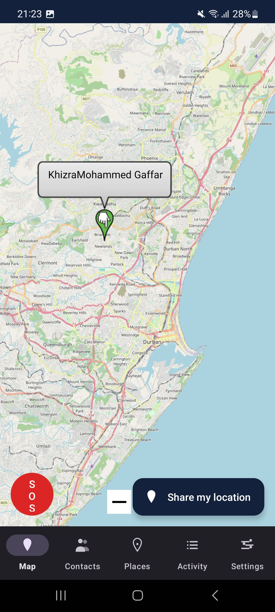
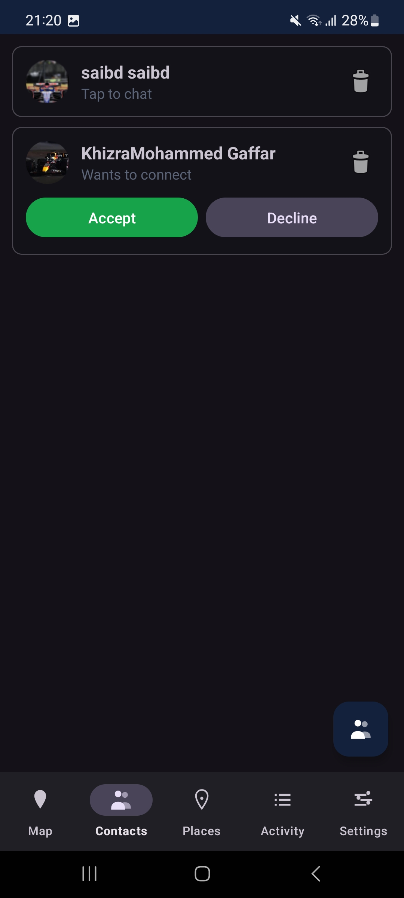
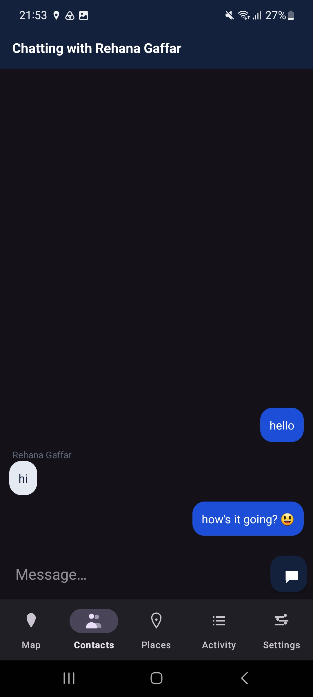
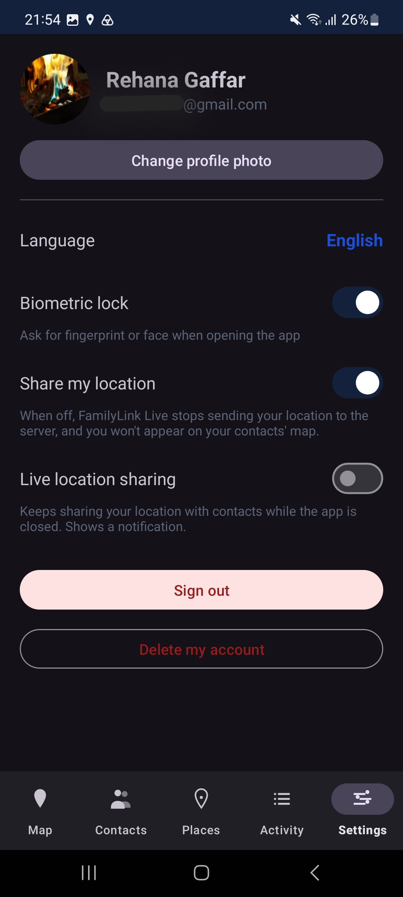
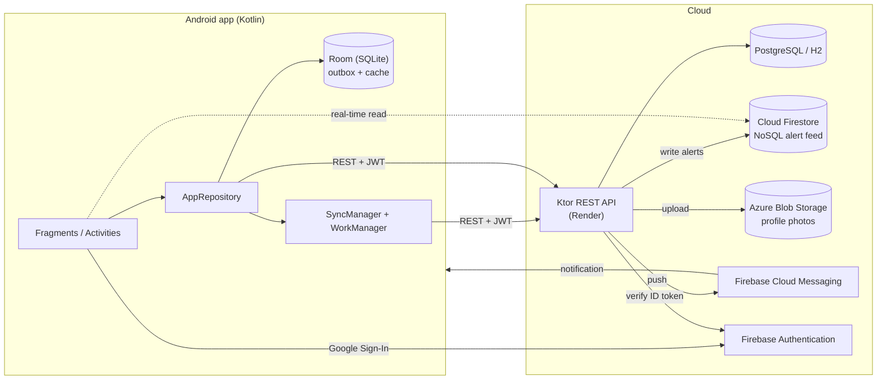
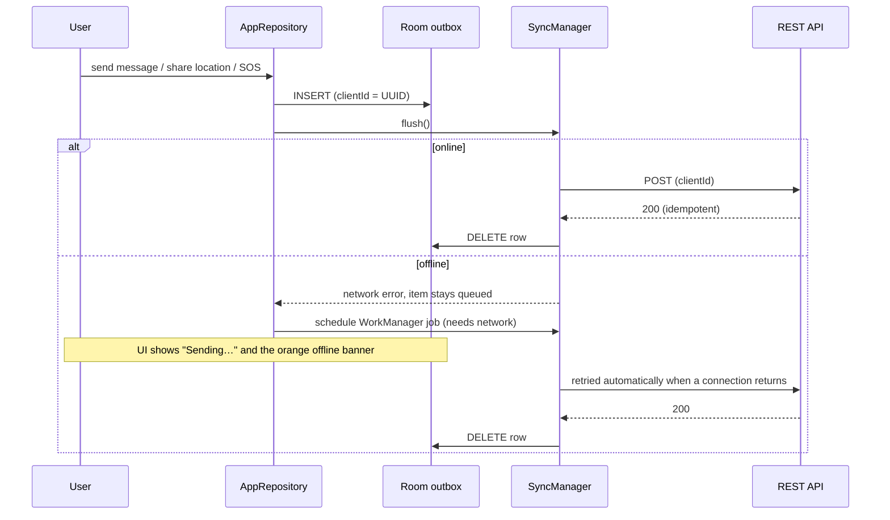
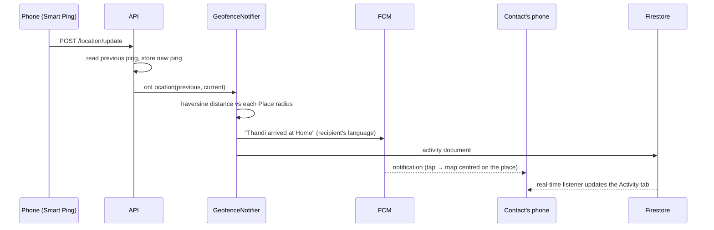

# FamilyLink Live

**PROG7314 / OPSC7312 — Portfolio of Evidence · Final POE (v3.0.0)**

FamilyLink Live is a native Android app (Kotlin) that lets families and close friends share their live location,
message each other privately, get arrival / departure alerts for places that matter, and raise an emergency SOS.
It is backed by a custom REST API (Kotlin + Ktor) that the group built, a PostgreSQL / H2 database, Firebase
(sign-in, push notifications, a NoSQL alert feed) and Azure Blob Storage (profile photos).

| | |
|---|---|
| **Demo video** | https://youtu.be/Ow5Y94ZI6ms |
| **Final tag** | `Final-POE` |
| **Release notes** | [RELEASE_NOTES.md](RELEASE_NOTES.md) |
| **Play Store material** | [store-assets/](store-assets/) |

> **Group:** ST10456110 Mohammed Amaan Gaffar · ST10315122 Nikhil Rajkumar · ST10456550 Talhah Patel · ST10260039 Veolin Naidoo

## Screenshots

<!-- Add your own device screenshots to docs/screenshots/ and keep these lines. -->
| Map | Contacts | Chat | Settings |
|---|---|---|---|
|  |  |  |  |

## 1. Features

### Required by the brief
| Requirement | How it is met | Where |
|---|---|---|
| **Single sign-on** | Google Sign-In → Firebase Auth → ID token verified **server-side** (Firebase Admin) → app JWT | `ui/login/LoginActivity.kt`, `backend/.../FirebaseAdmin.kt` |
| **Biometric authentication** | AndroidX `BiometricPrompt` (fingerprint / face; device PIN on Android 11+). One-time offer after first login, toggle in Settings, re-locks after 30 s in the background | `util/BiometricHelper.kt`, `ui/main/MainActivity.kt` |
| **Settings** | Language, biometric lock, location privacy, live sharing, profile photo, sign out, delete account — all persisted | `ui/settings/SettingsFragment.kt` |
| **REST API + database** | 19 endpoints + health check, JWT-secured, Exposed ORM over PostgreSQL (H2 locally) | `backend/` |
| **Offline mode + sync** | Room outbox + read cache; WorkManager retries; idempotent server; live "offline / syncing" banner | `data/local/`, `sync/`, `data/AppRepository.kt` |
| **Real-time notifications** | Firebase Cloud Messaging, data-only high-priority pushes, per-type channels, tap-to-open routing | `push/`, `backend/.../notifications/` |
| **Multi-language** | English, **Afrikaans**, **isiZulu** — whole UI *and* push text, switchable in-app instantly | `res/values-af`, `res/values-zu`, `util/LocaleHelper.kt` |
| **Production assets** | Adaptive + themed launcher icon, 512 px store icon, 1024×500 feature graphic | `res/mipmap-*`, `store-assets/` |
| **Blob storage** | Profile photos → Azure Blob Storage through the API | `backend/.../storage/BlobStorage.kt` |
| **NoSQL write + read** | Backend **writes** alert documents to Cloud Firestore; the app **reads** them with a real-time listener | `notifications/ActivityFeed.kt`, `ui/activity/ActivityFragment.kt` |

### User-defined features
| # | Feature | Summary |
|---|---|---|
| 1 | Live map (Part 2) | Pins for **accepted** contacts only, OpenStreetMap (no API key) |
| 2 | Places (Part 2) | Create / edit / delete geofences, optional arrival auto-message |
| 3 | Contacts + private chat (Part 2) | Email invite → accept → private per-contact thread |
| 4 | **Geofence alerts** (Part 3) | The server detects arrivals/departures and notifies contacts in *their* language; arrival auto-message posts into chat |
| 5 | **Emergency SOS** (Part 3) | Press-and-hold + 5-second cancellable countdown → high-priority alert with exact location to every contact; queued if offline |

Also new in Part 3: **Smart Ping** battery-aware background location (15 s driving / 60 s walking / 5 min still),
silent re-login when the 24 h session token expires, and in-app **account deletion** (a Google Play requirement).

## 2. Architecture



### Offline write path (messages, location, SOS)


### Geofence alert path (User-Defined Feature 4)


## 3. Data stores

| Store | Holds | Why this one |
|---|---|---|
| Firebase Authentication | Identity (Google SSO) | No passwords to build or leak |
| PostgreSQL (H2 locally) | Users, contacts, pings, places, messages, SOS events, push tokens | Relational, consistent, owned by our API |
| Cloud Firestore (NoSQL) | Alert history per user | Real-time listeners + built-in offline cache |
| Azure Blob Storage | Profile photos | Binary files don't belong in a database |
| Room (on device) | Offline outbox + read cache | Lets the app work with no connection |

## 4. REST API (19 endpoints plus a health check; everything except `/` and `/auth/login` needs `Authorization: Bearer <JWT>`)

| Method & route | Purpose |
|---|---|
| `GET /` | Health check |
| `POST /auth/login` | Exchange a Firebase ID token for the app JWT (creates the user on first login) |
| `PATCH /users/me/settings` | Language (EN/AF/ZU), location sharing, biometric flag |
| `POST /users/me/fcm-token` · `DELETE /users/me/fcm-token` | Register / remove this phone's push token |
| `POST /users/me/photo` | Upload profile photo (JPEG ≤ 2 MB) → Azure Blob |
| `DELETE /users/me` | Delete account and all related data (DB, Firestore, Blob, Firebase Auth) |
| `POST /contacts/invite` · `GET /contacts` | Invite by email · list (pending in both directions) |
| `POST /contacts/{id}/accept` · `DELETE /contacts/{id}` | Accept · decline / cancel / remove |
| `POST /location/update` · `GET /map/contacts` | Store a ping (+ geofence check) · latest pins of accepted contacts |
| `POST /places` · `GET /places` · `PATCH /places/{id}` · `DELETE /places/{id}` | Geofence CRUD |
| `POST /chat/send` · `GET /chat/messages?contactId=` | Private thread (idempotent on `clientMessageId`) |
| `POST /sos/trigger` | Emergency alert to all accepted contacts (idempotent on `clientId`) |

## 5. Project layout

```
FamilyLinkLive/
├── app/                      Android app (Kotlin, ViewBinding, Room, WorkManager, Navigation)
│   └── src/main/java/com/familylinklive/app/
│       ├── data/             API client, repository, Room database (data/local)
│       ├── sync/             SyncManager, SyncWorker, NetworkMonitor
│       ├── push/             FCM service, notification channels, token registration
│       ├── location/         Smart-Ping foreground service
│       ├── ui/               login, main, map, contacts, chat, places, activity, settings, sos
│       └── util/             biometric, locale, image, location helpers
├── backend/                  Ktor REST API (Exposed, Firebase Admin, Azure Blob client)
├── firebase/firestore.rules  Security rules for the Firestore feed
├── store-assets/             Play Store icon, feature graphic, listing text
├── docs/                     Setup guide, AI write-up, privacy policy, video script
└── .github/workflows/        CI: build + unit tests on every push
```

## 6. Testing and DevOps

* **Unit tests (run on every push by GitHub Actions)** — Android: place validation, offline message merge,
  Smart Ping, language codes, sync retry policy. Backend: haversine geofence maths, arrival/departure logic,
  Afrikaans / isiZulu / English notification text, route smoke tests.
* **CI** — `.github/workflows/android-ci.yml` runs `testDebugUnitTest` then `assembleDebug` and uploads the APK and
  test report; `backend-ci.yml` runs `./gradlew build`. Both run on **every branch**. A stub `google-services.json`
  is generated automatically when the real one isn't available, so CI never depends on a private file.
* **Version control** — small, descriptive commits by all four members; the final submission commit is tagged
  `Final-POE`.
* **Logging** — `android.util.Log` is used throughout (lifecycle, auth, sync, biometric, FCM, location). Tokens and
  message contents are never logged.

## 7. Release and Play Store readiness

* Version `3.0.0` (code 3), target SDK 34, min SDK 25, signed with a private release keystore (never committed).
* Adaptive + monochrome launcher icon, 512 px icon, 1024×500 feature graphic, listing text, data-safety answers,
  privacy policy and in-app account deletion are all provided — see [store-assets/STORE_LISTING.md](store-assets/STORE_LISTING.md).
* Foreground service of type `location` is user-controlled and shows a persistent notification.

## 8. Known limitations

* Chat is near-real-time (5 s polling while open) plus an instant FCM push; it is not a WebSocket.
* Places, invitations and account changes need a connection; offline mode covers chat, location sharing, SOS and reading cached data.
* Geofence detection has no hysteresis, so GPS jitter exactly on a boundary can cause repeat alerts.
* Afrikaans / isiZulu text was machine-assisted and should be proof-read by a first-language speaker.
* Render's free tier sleeps after ~15 minutes idle; the first request afterwards can take 30–60 s.

## 9. Credits and referencing

External patterns are cited in the source as comment blocks (Title / Author / Date / Version / Type / Availability)
at the point they are used. Libraries: Retrofit, OkHttp, Room, WorkManager, Navigation, Material Components,
osmdroid, Coil, Firebase (Auth, Messaging, Firestore, Admin SDK), Ktor, Exposed, java-jwt.
